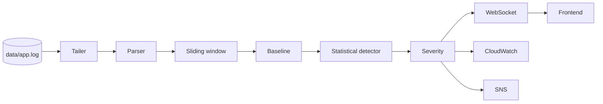

# Real-Time Log Anomaly Detector with Alert Feed

Watch a continuously growing application log, learn what "normal" looks like,
and raise severity-ranked alerts the moment something deviates. Alerts are
streamed live to a web feed and published to AWS CloudWatch and SNS.

> **Status:** scaffolding. Only `GET /health` is implemented. Everything else
> is a documented stub. See [Roadmap](#roadmap).

## The problem

Production logs grow by thousands of lines a minute. Incidents such as a
database timing out or a service going quiet are buried in that stream and are
usually noticed late, by a human scrolling or a customer complaining. We want
a service that:

1. **Ingests a growing log file in real time** by tailing it, not batch re-reading it.
2. **Parses** each line into timestamp, level, service, and message.
3. **Aggregates** events into **sliding time windows** (volume, error rate, …).
4. **Learns a baseline** of normal behaviour from recent windows.
5. **Detects anomalies** by comparing each new window to the baseline.
6. **Classifies severity** as `NORMAL`, `LOW`, `MEDIUM`, or `HIGH`.
7. **Pushes live updates** (metrics and alerts) to a frontend over WebSockets.
8. **Publishes to AWS**: metrics to **CloudWatch**, notifications to **SNS**.
9. **Explains** each alert: what deviated, by how much, with sample lines.

### Minimum requirements vs. stretch goals

| Must work for the demo                                  | Only after the minimum works           |
|---------------------------------------------------------|----------------------------------------|
| Tail → parse → window → baseline → **statistical** detector → severity | Isolation Forest detector |
| `GET /metrics`, `GET /alerts`, `WS /ws/metrics`, `WS /ws/alerts` | DeepLog-style LSTM detector   |
| Frontend live chart + alert feed                        | Persistent storage                     |
| CloudWatch metrics + SNS alerts (LocalStack OK)         | Advanced explanations                  |

**The core statistical detector comes first.** Advanced ML is optional and
must not block the minimum pipeline.

## Architecture

```
growing log file → parser → sliding window → baseline → anomaly detection → severity
                                                                              ├─→ WebSocket → frontend (live chart + alert feed)
                                                                              └─→ CloudWatch metrics + SNS notifications
```



Details: [`docs/architecture.md`](docs/architecture.md) ·
API: [`docs/api-contract.md`](docs/api-contract.md) ·
Detector: [`docs/model-card.md`](docs/model-card.md) ·
Demo: [`docs/demo-script.md`](docs/demo-script.md)

## Repository layout

```
.
├── backend/
│   ├── app/
│   │   ├── main.py              FastAPI app (GET /health)
│   │   ├── config.py            Settings (env / .env)
│   │   ├── api/                 health, metrics, alerts, websockets routes
│   │   ├── core/                tailer, parser, window, baseline, detector, severity, pipeline
│   │   ├── ml/                  OPTIONAL Isolation Forest / DeepLog LSTM
│   │   ├── explain/             alert explanations
│   │   ├── publishers/          WebSocket, CloudWatch, SNS
│   │   ├── models/              shared Pydantic schemas (Severity, Alert, ...)
│   │   └── db/                  in-memory alert/metrics store
│   ├── artifacts/               trained model files (git-ignored contents)
│   ├── tests/
│   ├── requirements.txt
│   ├── requirements-dev.txt     + pytest, httpx2 (TestClient)
│   ├── Dockerfile
│   └── .env.example
├── frontend/                    live dashboard (Person 1)
├── scripts/                     log generator, anomaly injector
├── data/app.log                 small sample log (ends with an error burst)
├── docs/                        api-contract, architecture, model-card, demo-script
├── infra/localstack/            local AWS emulator setup
├── ml_research/                 optional ML experiments
└── docker-compose.yml
```

## Quickstart

Requires Python 3.10+.

```bash
cd backend
python -m venv .venv
# Windows: .venv\Scripts\activate    macOS/Linux: source .venv/bin/activate
pip install -r requirements.txt
cp .env.example .env                  # optional, defaults work without it
uvicorn app.main:app --reload
```

```bash
curl http://localhost:8000/health
# {"status":"ok","service":"log-anomaly-detector"}
```

Interactive API docs: <http://localhost:8000/docs>

### Tests

```bash
cd backend
pip install -r requirements-dev.txt
pytest
```

### Docker

```bash
docker compose up --build                 # backend only
docker compose --profile aws up --build   # backend + LocalStack (CloudWatch/SNS)
```

## Configuration

All keys are in [`backend/.env.example`](backend/.env.example):

| Key                                   | Default                | Purpose                                 |
|---------------------------------------|------------------------|-----------------------------------------|
| `LOG_FILE_PATH`                       | `<repo>/data/app.log`  | File to tail                            |
| `POLL_INTERVAL_SECONDS`               | `1.0`                  | Tail polling interval                   |
| `WINDOW_SIZE_SECONDS`                 | `60`                   | Sliding window length                   |
| `BASELINE_WINDOW_COUNT`               | `30`                   | Windows in the rolling baseline         |
| `SEVERITY_{LOW,MEDIUM,HIGH}_THRESHOLD`| `2.0 / 3.0 / 4.0`      | Anomaly score → severity                |
| `AWS_REGION`                          | `us-east-1`            |                                         |
| `AWS_ENDPOINT_URL`                    | unset                  | Set for LocalStack                      |
| `CLOUDWATCH_ENABLED`                  | `false`                |                                         |
| `CLOUDWATCH_NAMESPACE`                | `LogAnomalyDetector`   |                                         |
| `SNS_ENABLED`                         | `false`                |                                         |
| `SNS_TOPIC_ARN`                       | unset                  | Required when SNS is enabled            |
| `SNS_MIN_SEVERITY`                    | `HIGH`                 | Minimum severity sent to SNS            |

**Never commit secrets.** `.env` is git-ignored. AWS credentials are not a
setting: boto3 reads them from the standard AWS credential chain.

## Team ownership

| Person   | Owns                                                                  |
|----------|-----------------------------------------------------------------------|
| Person 1 | `frontend/`: live metrics chart, alert feed, connection status        |
| Person 2 | Backend detection: `app/core/`, `app/api/` REST, `app/db/`, `app/explain/`, (later) `app/ml/` |
| Person 3 | WebSockets, integration, `scripts/`, `app/publishers/` (WebSocket, CloudWatch, SNS), `infra/` |
| Person 4 | `backend/tests/`, `docs/`, `README.md`, final QA and demo run-through |

The API contract in [`docs/api-contract.md`](docs/api-contract.md) is the
hand-off point between people. Change it in a PR before changing any payload.

## Roadmap

1. **Core pipeline:** tailer, parser, sliding window, baseline, statistical
   detector, severity (Person 2)
2. **API:** `GET /metrics`, `GET /alerts` (Person 2), `WS /ws/metrics`,
   `WS /ws/alerts` (Person 3)
3. **Demo tooling:** log generator + anomaly injector (Person 3)
4. **Frontend:** live chart + alert feed (Person 1)
5. **AWS:** CloudWatch + SNS publishers via LocalStack (Person 3)
6. **Tests, docs, QA** throughout (Person 4)
7. *Optional:* Isolation Forest → DeepLog LSTM, only after 1–6 work

## Contributing

- Branch from `main` and open a PR. Don't push directly to `main` once work starts.
- Never force-push shared branches or rewrite published history.
- Never commit secrets, credentials, `.env` files, or real production logs.
