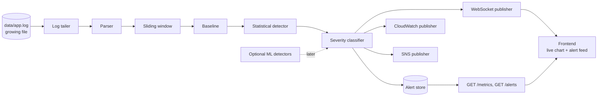

# Architecture

## Pipeline



Text version:

```
growing log file → parser → sliding window → baseline → anomaly detection → severity
                                                                              ├─→ WebSocket → frontend
                                                                              └─→ CloudWatch metrics + SNS alerts
```

## Components → modules

| Stage                | Module                                           | Owner    |
|----------------------|--------------------------------------------------|----------|
| Log tailer           | `backend/app/core/log_tailer.py`                 | Person 2 |
| Parser               | `backend/app/core/log_parser.py`                 | Person 2 |
| Sliding window       | `backend/app/core/sliding_window.py`             | Person 2 |
| Baseline             | `backend/app/core/baseline.py`                   | Person 2 |
| Statistical detector | `backend/app/core/statistical_detector.py`       | Person 2 |
| Severity             | `backend/app/core/severity_classifier.py`        | Person 2 |
| Explanations         | `backend/app/explain/alert_explainer.py`         | Person 2 |
| Pipeline wiring      | `backend/app/core/pipeline.py`                   | Person 2 + 3 |
| Alert/metrics store  | `backend/app/db/alert_store.py`                  | Person 2 |
| REST API             | `backend/app/api/{health,metrics,alerts}.py`     | Person 2 |
| WebSockets           | `backend/app/api/websockets.py`, `publishers/websocket_publisher.py` | Person 3 |
| CloudWatch / SNS     | `backend/app/publishers/{cloudwatch,sns}_publisher.py` | Person 3 |
| Schemas (contract)   | `backend/app/models/schemas.py`                  | Person 2 + 3 |
| Optional ML          | `backend/app/ml/`, `ml_research/`                | Person 2 (stretch) |
| Frontend             | `frontend/`                                      | Person 1 |
| Demo scripts         | `scripts/`                                       | Person 3 |
| Tests / docs / QA    | `backend/tests/`, `docs/`, `README.md`           | Person 4 |

## Runtime model

- A single FastAPI process (uvicorn).
- On startup (FastAPI lifespan), `pipeline.py` starts one asyncio background
  task that tails the log file every `POLL_INTERVAL_SECONDS`.
- Each time a window of `WINDOW_SIZE_SECONDS` closes, the pipeline:
  1. computes window metrics,
  2. scores them against the baseline,
  3. classifies severity,
  4. stores the snapshot (and an alert if severity ≠ `NORMAL`),
  5. fans out to publishers.
- Publishers are independent. A failing publisher (e.g. AWS unreachable) logs
  and moves on, and never blocks detection or the WebSocket feed.
- State is in memory. Restarting the backend resets the baseline (warm-up again).

## Log format

One event per line:

```
YYYY-MM-DD HH:MM:SS,mmm LEVEL [service] message
```

Example:

```
2026-09-28 10:04:02,847 ERROR [payment-service] Database connection timeout after 5000ms
```

| Part      | Values                                  |
|-----------|-----------------------------------------|
| timestamp | Local log time, treated as UTC          |
| LEVEL     | `DEBUG`, `INFO`, `WARN`, `ERROR`        |
| service   | Free text inside `[ ]`                  |
| message   | Rest of the line, may contain `key=val` |

Suggested regex:

```
^(?P<ts>\d{4}-\d{2}-\d{2} \d{2}:\d{2}:\d{2},\d{3}) (?P<level>DEBUG|INFO|WARN|ERROR) \[(?P<service>[^\]]+)\] (?P<message>.*)$
```

Lines that do not match are counted as malformed and skipped, never fatal.
`scripts/generate_logs.py` and `scripts/inject_anomaly.py` must write this format.

## Detection approach

1. **Core (required): statistical.** Per window, compare `line_count` and
   `error_rate` against a rolling mean/std of the last `BASELINE_WINDOW_COUNT`
   normal windows. `anomaly_score` = max absolute z-score. Map to severity with
   configurable thresholds. See [`model-card.md`](model-card.md).
2. **Optional (only after the core works end to end):** Isolation Forest over
   window feature vectors, and a DeepLog-style LSTM over log-key sequences.
   These run *alongside* the statistical detector and must not replace it.

## Configuration

All settings live in `backend/app/config.py` and are overridable by env vars /
`backend/.env`. See `backend/.env.example`. Secrets are never settings. AWS
credentials come from the standard AWS credential chain.

## AWS integration

| Service    | Used for                               | Toggle               |
|------------|----------------------------------------|----------------------|
| CloudWatch | Per-window metrics (`put_metric_data`) | `CLOUDWATCH_ENABLED` |
| SNS        | Notifications for alerts ≥ `SNS_MIN_SEVERITY` | `SNS_ENABLED`  |

Both are **off by default**, so the app runs with no AWS at all. For local
development use LocalStack (`infra/localstack/`).
